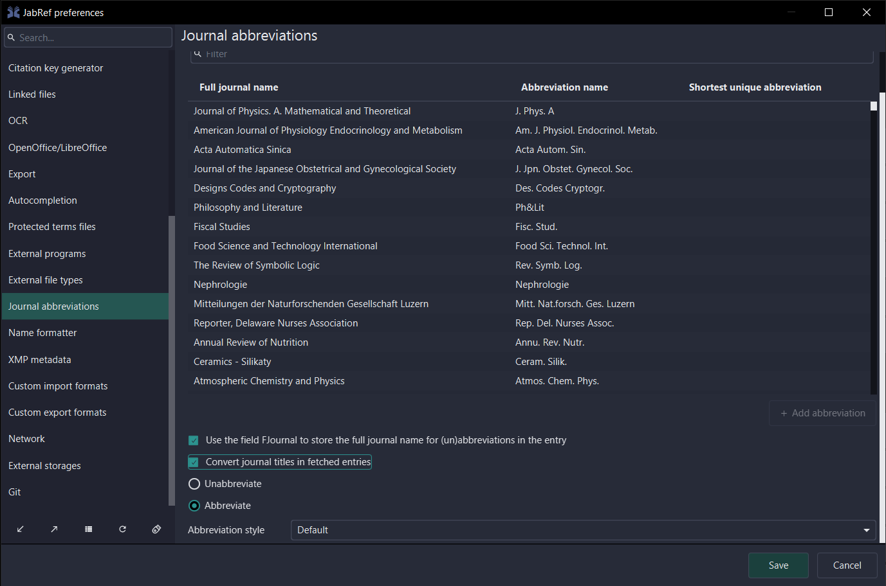
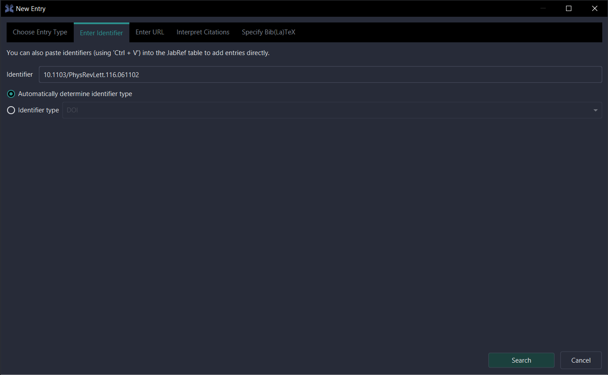
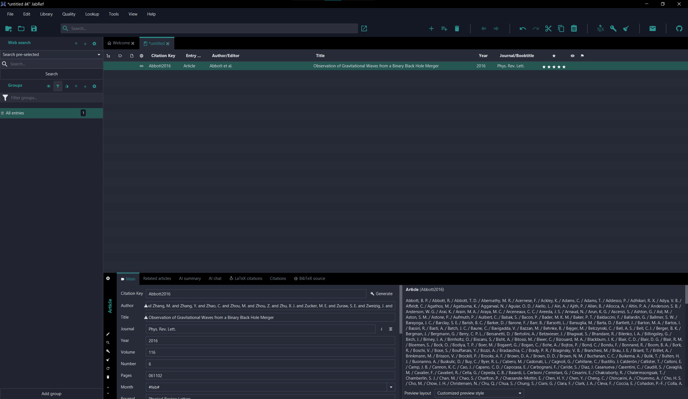
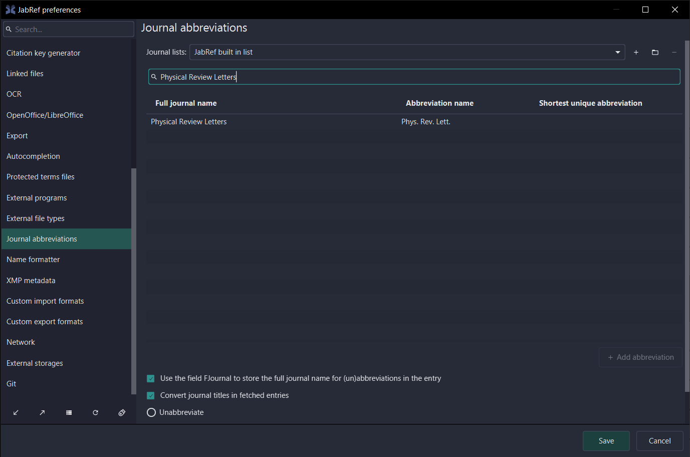

### Summary

Added user preferences to the Journal abbreviations tab that allows the user to choose whether they want the journal (un)abbreviation clean up to be automatically run on fetched entries, and whether it should be unabbreviation, or abbreviation with a particular type. When the preference is set, the corresponding clean up is called upon fetched entries.

Changes were made in various GUI locations where a newly fetched entry is processed, because different types of fetchers have different processing pipelines. No single location could be identified that would affect all fetched entries without also affecting entries added via other means.

### Steps to test

1. Open File > Preferences > Journal abbreviations, tick Convert journal titles in fetched entries and press save.

2. In a library, press Add entry using..., type in the DOI `10.1103/PhysRevLett.116.061102`, and press Search.

3. The entry is added with the journal title abbreviated to the abbreviation defined in the Jabref built in list.

4. Similarly, automatic abbreviation to the other styles or automatic unabbreviation can be done. And when Convert journal titles in fetched entries is left unticked, the journal title remains unconverted.

### Related issues and pull requests

Closes https://github.com/JabRef/jabref/issues/11305

### AI usage

_____

DeepWiki and GitHub CoPilot were used to understand the codebase and identify the locations for calling the clean up.

Codex (GPT-6.1 Sol) and GitHub CoPilot were used to assist with creating and extending test cases, and recommend changes to adhere to the style guide.

AI CHECKLIST.md walkthrough

# Code checklist

> [!IMPORTANT]
> **This is a mandatory final gate.** When the implementation is finished and before you open a PR, work through **every** box below and tick it. If a box cannot be ticked, fix the code first; mark a box `[/]` only if the point genuinely does not apply.
>
> `AGENTS.md` describes how to write code *while* developing — this file confirms the finished result. Do not skip the checklist and do not skip individual points.

## 1. Code self-review

Read your own diff once, top to bottom, and confirm each point.

### Nullability and control flow

- [x] No `== null` / `!= null` checks — JSpecify annotations (`@NullMarked`, `@Nullable`, `@NonNull`) used instead.
- [x] No `Objects.requireNonNull(...)` — nullability expressed via JSpecify annotations.
- [x] New classes annotated with `@NullMarked` (`org.jspecify.annotations.NullMarked`).
- [/] New packages annotated with `@NullMarked` (`org.jspecify.annotations.NullMarked`).
- [x] `Optional` consumed with `ifPresent` / `ifPresentOrElse` / `map` / `orElseThrow` — never `orElse(unusedValue)` nor an `isPresent()` + `get()` block.
- [/] `StringUtil.isBlank(...)` used instead of `s == null || s.isBlank()`.

### Exceptions

- [x] No `catch (Exception e)` — only specific exceptions are caught.
- [x] No `throw new RuntimeException(...)` / `IllegalStateException(...)` — these tear down the whole application.
- [/] Logged exceptions are passed as the **last** logger argument (`LOGGER.info("...", e)`), not concatenated into the message string.

### Style and idioms

- [x] New `BibEntry` objects built with withers (`withField`, not `setField`).
- [x] Modern Java used: `List.of()` / `Map.of()` / `Set.of()`, `Path.of()`, `SequencedCollection` / `SequencedSet`, text blocks.
- [/] Regexes use a precompiled `Pattern.compile(...)` constant, not `String.matches(...)`.
- [x] Keep alphabetical ordering when adding variables or enum items.
- [/] Background work uses `org.jabref.logic.util.BackgroundTask`, not `new Thread()`.
- [x] No commented-out code, no trivial comments restating the code, no AI-disclosure comments in source.
- [/] Markdown Javadoc (`///`) uses Markdown syntax, not JavaDoc inline tags: `` `code` `` instead of `{@code}`, `[ClassName]` instead of `{@link}`.

### User-facing text

- [x] All user-facing text localized (`Localization.lang` in Java, `%` prefix in FXML).
- [x] Sentence case (not Title Case); no trailing `!`; labels do not end with `:`.
- [/] Variance expressed with placeholders (`"...: %0"`), not string concatenation.

### Security

- [/] User-controlled data (request params, entry fields, file contents) is HTML-escaped before being written into any `text/html` response — including exception/error messages, not just the success body (XSS).

### Tests

- [/] In case issue lists an example, this concrete example is covered by a test case.
- [x] Behavior changes in `org.jabref.model` / `org.jabref.logic` have added or updated tests.
- [x] Tests assert object contents (`assertEquals`), use plain JUnit asserts (not AssertJ), have no `@DisplayName`, do not catch exceptions (let them propagate so JUnit reports setup/teardown failures directly), and use `@TempDir` instead of manual temp directories.
- [/] Fetcher tests hit the live endpoints — the remote API is not mocked or stubbed (automated-review suggestions to mock it are rejected on purpose).

## 2. Verification commands

Run in this order — cheapest first. Each must pass.

- [ ] `./gradlew :jablib:check` (or `./gradlew check` for all modules).
- [x] `./gradlew checkstyleMain checkstyleTest checkstyleJmh`.
- [x] `./gradlew modernizer`.
- [x] `./gradlew --no-configuration-cache :rewriteDryRun` reports no changes (run `./gradlew rewriteRun` to fix).
- [x] `./gradlew javadoc`.
- [x] `npx markdownlint-cli2 "docs/**/*.md" "*.md"` (only if Markdown changed).
- [x] `npm ci && npm run textlint` reports no misspellings (only if Markdown changed).
- [/] Only if formatting is still off after `rewriteRun`: `docker run -v $(pwd):/github/workspace ghcr.io/leventebajczi/intellij-format:master "*.java" "" ".idea/codeStyles/Project.xml"`.

## 3. Documentation

- [x] `CHANGELOG.md` entry added if the change is visible to the user (end-user wording, no extra blank lines, sorted in next to existing entries about the same component/feature). Link the issue if one exists; link the PR only when no issue exists. Use `TODO` as the placeholder when neither is known yet — never a fake number. No entry for fixes to changes that were themselves introduced after the last release (feature only in `## [Unreleased]`) — update the existing unreleased entry instead if needed.
- [x] Searched [jabref/issues](https://github.com/JabRef/jabref/issues) and [jabref-koppor/issues](https://github.com/JabRef/jabref-koppor/issues) for a related issue; linked only on a confident match, otherwise kept `TODO` (no `closes`/`fixes` for merely-similar issues).
- [x] Requirement added to `docs/requirements/<area>.md` if the change is a new feature or significant bug fix (skip for refactors, minor fixes, and internal changes).
- [x] Developer documentation under `docs/` updated if behavior or architecture changed.

## 4. Pull request

- [x] PR body built from `.github/PULL_REQUEST_TEMPLATE.md`, every section filled.
- [x] All checklist items kept and marked `[x]`, `[ ]`, or `[/]`.
- [x] "Steps to test" is a numbered list with a cropped screenshot of the result for every visible change; no video (only allowed when another program is involved, e.g. drag and drop or push to an external application).
- [x] All HTML comments removed from the PR body.
- [x] PR created with `gh pr create --body-file <file>` (not `--body`).
- [/] If `CHANGELOG.md` used a `TODO` placeholder (no issue confidently identified yet — an existing issue link always stays), the PR was opened as draft, the placeholder was replaced with the real PR-number link after PR creation, committed and pushed, and only then was the PR marked ready for review. If an issue is identified or created later, the link is switched to the issue.

### Checklist

- [x] I own the copyright of the code submitted and I license it under the [MIT license](https://github.com/JabRef/jabref/blob/main/LICENSE)
- [x] If AI tools were used, I disclosed them in the "AI usage" section and reviewed, understood, and take full ownership of all AI-generated code
- [x] I manually tested my changes in running JabRef (always required)
- [x] I added JUnit tests for changes (if applicable)
- [x] I added screenshots in the PR description (if change is visible to the user)
- [x] I added **one sentence (max 20 words)** to `CHANGELOG.md` describing the change from the user's point of view (if the change is visible to the user)
- [ ] I checked the [user documentation](https://docs.jabref.org/) for up to dateness and submitted a pull request to our [user documentation repository](https://github.com/JabRef/user-documentation/tree/main/en)
